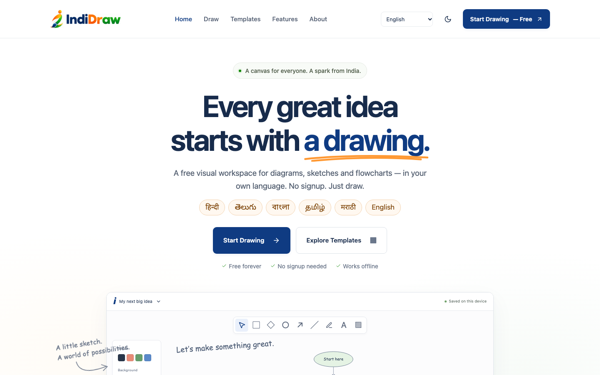
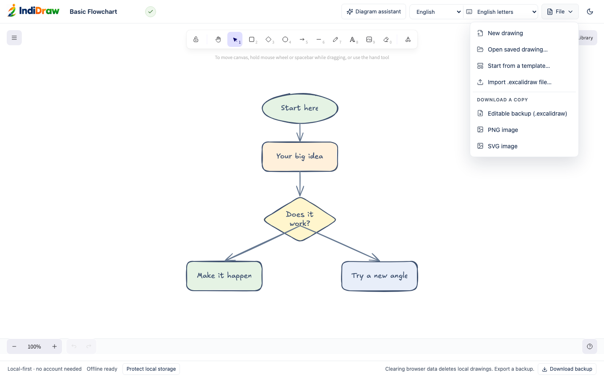
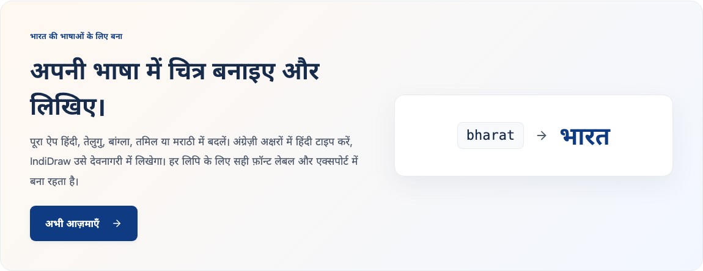
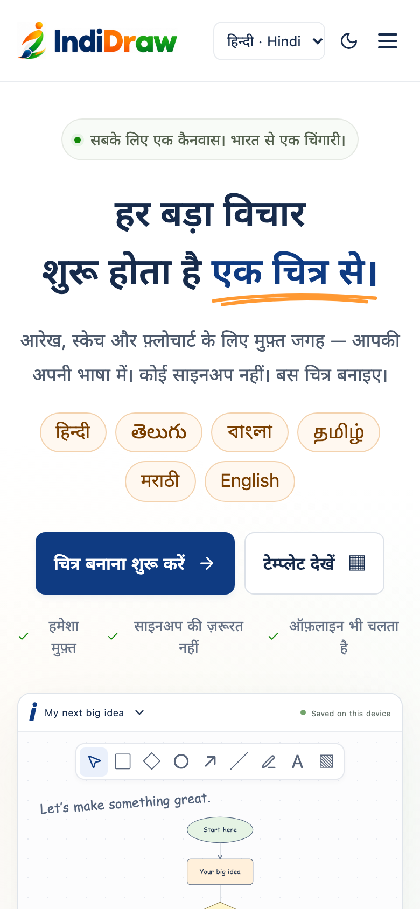

<div align="center">


### Where ideas take shape.

A free, local-first whiteboard for diagrams, sketches and flowcharts — in English and five Indian languages.

[](https://github.com/ravi4chan/indidraw/actions/workflows/ci.yml)
[](LICENSE)


[Features](#features) · [Quick start](#quick-start) · [Languages](#indian-languages) · [Architecture](docs/ARCHITECTURE.md) · [Deploy](docs/DEPLOYMENT.md) · [Contributing](CONTRIBUTING.md)



</div>

## About

IndiDraw is a visual workspace built on the open-source [Excalidraw](https://github.com/excalidraw/excalidraw) editor. It runs entirely in the browser: no account, no backend, no analytics and no AI service. Drawings are saved on your device and the app keeps working offline once it has been opened.

What sets it apart is first-class support for Indian languages. The interface is available in **Hindi, Telugu, Bengali, Tamil and Marathi**, Hindi can be typed phonetically with an English keyboard (`namaste` → `नमस्ते`), and every script ships with a bundled Noto font so canvas text, labels and exports render correctly on any device.

> IndiDraw is an independent software initiative. It is not affiliated with or endorsed by the Indian Army or the Government of India.

## Features

<table>
<tr>
<td width="50%" valign="top">

**Drawing**

- The full Excalidraw editor: shapes, arrows, freehand, text, images, library, undo/redo and keyboard shortcuts
- 13 editable templates, including three in Hindi, with search and category filters
- A **Diagram assistant** that turns `Roof → Filter → Tank` into connected shapes, shows a dashed preview first and can undo its change

</td>
<td width="50%" valign="top">

**Your work, your device**

- Autosave to IndexedDB with a clear saved / saving / not-saved badge
- Multiple local drawings, a reminder to name untitled work, and a gentle backup nudge
- Import and export `.excalidraw` files; export PNG and SVG
- Installable, offline-first app with a content-versioned service worker

</td>
</tr>
<tr>
<td valign="top">

**Indian languages**

- Interface in English, हिन्दी, తెలుగు, বাংলা, தமிழ், मराठी and മലയാളം, shared by the website and editor
- Offline phonetic typing for Hindi, Telugu, Bengali, Tamil, Marathi and Malayalam, with spelling choices beside the word; press 1–9 to pick one
- Six selectable canvas fonts (Noto Sans Devanagari, Telugu, Bengali, Tamil, Malayalam; Noto Serif Devanagari for Marathi)

</td>
<td valign="top">

**Quality**

- Strict TypeScript, ESLint and Prettier
- Unit tests (Vitest) and browser tests (Playwright) across Chromium and WebKit, including automated WCAG AA checks
- Restrictive Content Security Policy and hosting headers for Cloudflare

</td>
</tr>
</table>

## Screenshots

| Hindi phonetic typing                                                                                                               | Diagram assistant preview                                                                                                     |
| ----------------------------------------------------------------------------------------------------------------------------------- | ----------------------------------------------------------------------------------------------------------------------------- |
|  |  |
| **File menu**                                                                                                                       | **Made for India's languages**                                                                                                |
|     |                            |

<p align="center"></p>

## Quick start

**Requirements:** Node.js 22.12 or newer and [pnpm](https://pnpm.io/installation) 11.

```sh
git clone https://github.com/ravi4chan/indidraw.git
cd indidraw
pnpm install --frozen-lockfile
pnpm dev
```

Open the printed `localhost` address. The development server does not install the offline service worker; use a production preview to test offline behaviour:

```sh
pnpm build
pnpm preview --port 4173
```

### Scripts

| Command          | What it does                                                                                    |
| ---------------- | ----------------------------------------------------------------------------------------------- |
| `pnpm dev`       | Copies bundled fonts and starts the Vite dev server                                             |
| `pnpm build`     | Type-checks, copies fonts, builds the static site into `dist/` and generates the service worker |
| `pnpm preview`   | Serves the production build locally                                                             |
| `pnpm typecheck` | Runs the TypeScript compiler in strict mode                                                     |
| `pnpm lint`      | Runs ESLint on `src/` and `tests/`                                                              |
| `pnpm test`      | Runs unit tests with Vitest                                                                     |
| `pnpm test:e2e`  | Runs Playwright browser tests against the production preview                                    |
| `pnpm format`    | Formats the project with Prettier                                                               |

## Indian languages

Choose a language from the menu at the top of the site or editor; the choice is remembered on the device and shared between them.

| Language         | Interface                                                | Canvas font           | Typing                                |
| ---------------- | -------------------------------------------------------- | --------------------- | ------------------------------------- |
| English          | Full                                                     | Excalidraw defaults   | Keyboard                              |
| हिन्दी Hindi     | Full                                                     | Noto Sans Devanagari  | Phonetic (default) or device keyboard |
| తెలుగు Telugu    | Full; a few advanced Excalidraw messages stay in English | Noto Sans Telugu      | Phonetic (default) or device keyboard |
| বাংলা Bengali    | Full                                                     | Noto Sans Bengali     | Phonetic (default) or device keyboard |
| தமிழ் Tamil      | Full                                                     | Noto Sans Tamil       | Phonetic (default) or device keyboard |
| मराठी Marathi    | Full                                                     | Noto Serif Devanagari | Phonetic (default) or device keyboard |
| മലയാളം Malayalam | Full; a few advanced Excalidraw messages stay in English | Noto Sans Malayalam   | Phonetic (default) or device keyboard |

**Typing phonetically.** Pick the text tool, click the canvas and type with English letters: `namaste` → नमस्ते, `telugu` → తెలుగు, `bangla` → বাংলা, `vanakkam` → வணக்கம், `pustak` → पुस्तक, `malayalam` → മലയാളം. Each word becomes your language's script as you type, and a small panel under the word offers other spellings: press <kbd>Space</kbd> to keep the first, or <kbd>1</kbd>–<kbd>9</kbd> to choose another. Transliteration happens on the device; nothing is sent anywhere. See [docs/HINDI-TYPING.md](docs/HINDI-TYPING.md).

Translations are initial versions; native-speaker review is welcome. Terminology decisions and sources are recorded in [docs/LOCALIZATION.md](docs/LOCALIZATION.md).

## Diagram assistant

Open **Diagram assistant** in the editor and describe a diagram with simple commands:

```text
Roof → Filter → Storage tank → Garden

ellipse "Start"
box "Review"
diamond "Approved?"
connect "Start" → "Review"
rename "Review" to "Check"
```

Labels can be in any language. **Preview changes** draws a dashed outline on the canvas without touching your drawing; **Apply to canvas** adds native, editable Excalidraw shapes as one undoable step. The assistant runs entirely offline and does not use AI. The design and roadmap toward voice input are in [docs/VOICE-CANVAS.md](docs/VOICE-CANVAS.md).

## Data and privacy

- Drawings, titles and embedded images are stored in the browser's IndexedDB on your device. There is no server copy.
- Clearing site data, private browsing or losing the device can delete drawings. Use **File → Editable backup (.excalidraw)** to keep a copy; the app reminds you after a long session.
- **Protect local storage** asks the browser for persistent storage where supported.
- No accounts, cookies for tracking, analytics or third-party requests. See the in-app Privacy page and [SECURITY.md](SECURITY.md).

## Project structure

```text
src/
  App.tsx               Website: home, templates gallery, about and policy pages
  editor/               Excalidraw wrapper: header, File menu, saving, import/export
    assistant/          Diagram assistant: command protocol, scene adapter, preview
    transliteration/    Phonetic typing engines (six languages) and input adapter
  i18n/                 Language selection and translations (UI and site)
  storage/              IndexedDB drawings and personal library
  templates/            Template data and filters
scripts/                Font copying and service-worker generation
tests/                  Vitest unit tests; tests/e2e/ Playwright browser tests
docs/                   Architecture, localisation, deployment and QA records
public/                 Static assets, branding, fonts' licence notices, _headers
```

Read [docs/ARCHITECTURE.md](docs/ARCHITECTURE.md) for how the pieces fit together.

## Deployment

IndiDraw is a static site. Build it with `pnpm build` and serve the `dist/` folder from any static host over HTTPS. Cloudflare Pages and Workers static assets are documented and tested, including security headers and single-page-app routing: see [docs/DEPLOYMENT.md](docs/DEPLOYMENT.md).

Set the optional build-time variable `VITE_REPOSITORY_URL=https://github.com/ravi4chan/indidraw` to show a GitHub link in the site navigation.

## Testing

```sh
pnpm typecheck && pnpm lint && pnpm test
pnpm exec playwright install chromium webkit
pnpm build
pnpm test:e2e --project=chromium --project=webkit
```

Browser tests run against the production preview and cover saving, offline use, import/export, templates, languages and fonts, Hindi typing, the assistant, responsive layouts and automated accessibility scans. To rehearse the production security headers, run `INDIDRAW_CSP_TEST=1 pnpm test:e2e`. Release QA records live in [docs/VERIFICATION.md](docs/VERIFICATION.md) and [docs/FINAL-QA.md](docs/FINAL-QA.md).

## Roadmap

- Native-speaker review of all translations, and phonetic typing for more languages
- Voice input for the diagram assistant ([design](docs/VOICE-CANVAS.md))
- Real-device accessibility and complex-script export testing
- Optional, separately hosted cloud sync and collaboration — the free local editor stays independent of any cloud service

## Contributing

Contributions are welcome, especially translations, accessibility improvements and tests. Please read [CONTRIBUTING.md](CONTRIBUTING.md) and the [Code of Conduct](CODE_OF_CONDUCT.md). Report security issues privately as described in [SECURITY.md](SECURITY.md).

## License

IndiDraw's source code is released under the [MIT License](LICENSE). Excalidraw, the bundled fonts and other dependencies keep their own licences; see [THIRD_PARTY_NOTICES.md](THIRD_PARTY_NOTICES.md). The IndiDraw name and logo are the owner's brand assets and are not licensed under MIT; see [docs/BRANDING.md](docs/BRANDING.md).

## Acknowledgements

- [Excalidraw](https://github.com/excalidraw/excalidraw) for the drawing engine
- [Noto fonts](https://fonts.google.com/noto) for Indian-script typefaces, via [Fontsource](https://fontsource.org)
- [Sanscript](https://github.com/indic-transliteration/sanscript.js) for transliteration
- [Lucide](https://lucide.dev) for icons
