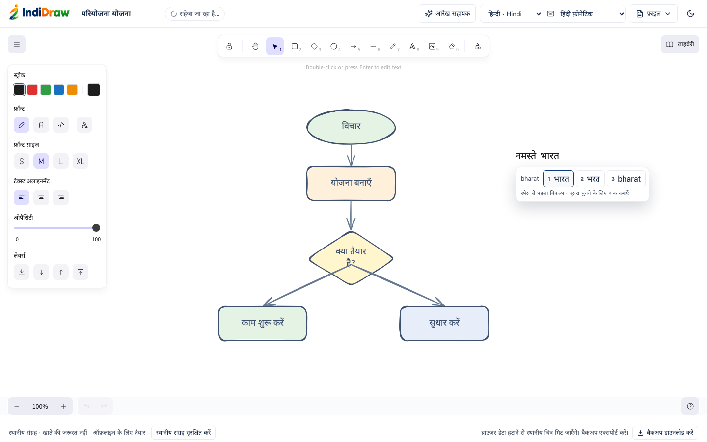

# Hindi phonetic typing

Type Hindi on the canvas with an ordinary English keyboard. Words are converted to Devanagari as you type, entirely on the device.

## How to use it

1. Choose **हिन्दी · Hindi** from the language menu. The keyboard control next to it switches to **Hindi phonetic** automatically. You can also pick Hindi phonetic from the keyboard control while using any other interface language.
2. Select the text tool (<kbd>T</kbd>), click the canvas and type using English letters, for example `namaste`.
3. The current word updates live, and a small panel under it lists other spellings and the original English letters:
   - <kbd>Space</kbd> or punctuation keeps the first choice and starts a new word.
   - <kbd>1</kbd>–<kbd>9</kbd> picks a numbered choice. You can also click or tap one.
4. Press <kbd>Escape</kbd> to finish editing as usual.

Capital letters are treated the same as lowercase, so phone keyboards that capitalise the first word of a sentence still work.

The keyboard control has three modes:

| Mode                  | Behaviour                                                               |
| --------------------- | ----------------------------------------------------------------------- |
| English letters       | Input is left exactly as typed                                          |
| Hindi phonetic        | New English letters become Hindi as you type                            |
| Device Hindi keyboard | Input from your device's Hindi keyboard or IME is left exactly as typed |

The mode follows the interface language each time the editor opens; it is not stored in drawings. Changing the mode or the language never converts text that is already on the canvas.

## Manual examples and checks

| Type using English keys     | Expected first result       |
| --------------------------- | --------------------------- |
| namaste                     | नमस्ते                      |
| bharat                      | भारत; भरत is an alternative |
| mera naam                   | मेरा नाम                    |
| aap kaise hain              | आप कैसे हैं                 |
| main hindi mein likhta hoon | मैं हिंदी में लिखता हूँ     |
| main hoon                   | मैं हूँ                     |
| shiksha kripya              | शिक्षा कृपया                |
| gyan shraddha               | ज्ञान श्रद्धा               |
| prarthana drishti           | प्रार्थना दृष्टि            |
| paani duniya                | पानी दुनिया                 |

1. Type `namaste bharat`. Backspace the last English keystroke, type `t` again, then Undo and Redo. The pending Roman buffer and Hindi spelling should recover together.
2. Select some existing text with the mouse or keyboard, type a new word, and check that only the selection changes. Move the caret into an old word to edit it normally. Devanagari selection/deletion then follows the browser's native behavior.
3. Copy `नमस्ते भारत`, move the caret, and paste it. Paste `namaste` too: both must stay exactly as pasted. Cut/paste must continue working.
4. Use a native Hindi keyboard (including an OS IME). Type vowel marks and conjuncts such as `क्षि`, `कृपया`, `श्रद्धा`. Native composition must not be transliterated a second time. English and Hindi Native Keyboard modes must also keep literal `namaste` unchanged.
5. Finish with Escape, wait for Saved on this device, reload and reopen the saved drawing. Export .excalidraw, PNG, and SVG. Import the .excalidraw backup and check the same Hindi content. SVG embeds Noto font data; PNG uses the same shaping fonts as the canvas.
6. Wait for Offline ready, disconnect the network, reload, type another Hindi word and export again. Do not clear site data to test offline mode: that also deletes local drawings.
7. Keep an existing English/Hindi drawing open, switch the language menu, and confirm that existing text has not changed.

## Implementation

The active Excalidraw 0.18.1 editor is `textarea[data-type="wysiwyg"]` inside `.editor-surface`. A scoped MutationObserver attaches and disposes a DOM input adapter as text editing starts and ends. It does not replace Excalidraw or modify its dependency source.

The adapter intercepts cancelable `beforeinput` events only for newly inserted ASCII letters in Hindi Phonetic mode. It replaces the active word with Unicode, retains a short-lived Roman buffer, and clears that buffer on cursor/selection changes, delimiters, paste, cut, or composition. Existing text is never searched for Roman words. Native composition and non-ASCII input pass through. Each replacement dispatches the normal input event to Excalidraw's existing geometry, shaping, rendering and saving path. Document titles and other UI fields are unaffected.

Programmatic textarea replacements do not enter native browser undo history consistently. Once a phonetic replacement occurs, the adapter therefore maintains up to 200 text-edit snapshots including caret, selection direction and Roman-buffer state. Ctrl/Cmd+Z, Shift+Ctrl/Cmd+Z, Ctrl+Y and browser history input events use these snapshots while that textarea is active. Untouched English/native sessions retain browser undo. Excalidraw's scene-level undo/redo is unchanged after text submission.

`hindi.ts` implements a language-neutral `Transliterator` interface. Only the Hindi engine is wired to the UI. It uses pinned `@indic-transliteration/sanscript` 1.3.3, with Hindi schwa-syncope enabled, plus IndiDraw's own common Hindi pronunciation/spelling preferences and alternatives. Other languages can later supply another implementation without changing the input adapter.

The library alone was explicitly evaluated: bare ITRANS produced `भरत`, `हिन्दि`, `क्रिप्य` and `मैन` for `bharat`, `hindi`, `kripya` and `main`. The Hindi layer corrects those everyday spellings. This is a deterministic offline helper with a finite common-word list, **not** a context-aware dictionary/model like Google Input Tools. Unlisted or ambiguous Roman spellings can still need explicit long vowels (aa/ii/ee/oo), an alternative, or correction with the native keyboard. It does not translate English words or sentences. No input is transmitted to a service.

### Licence and offline distribution

Sanscript is MIT licensed, Copyright (c) 2012-present learnsanskrit.org. Verified against the installed package's full LICENSE and upstream https://github.com/indic-transliteration/sanscript.js/blob/master/LICENSE . API and syncope behavior: https://github.com/indic-transliteration/sanscript.js . Full notices ship under `public/notices`; the dependency is pinned in package.json and pnpm-lock.yaml. The Vite bundle contains the engine and Hindi word list, and the existing generated service worker precaches them and the existing Noto fonts. There is no CDN, API, model download, or new backend.

### Existing integration points inspected

- Text editing, local scene saving, import and all three exports: `src/editor/Editor.tsx`.
- UI language choice and save/reload behavior: `src/i18n/languages.tsx` and Editor's `changeLanguage`.
- Selectable custom fonts: `src/editor/languageFonts.ts`; fallback shaping and SVG embedding: `src/editor/indicFonts.ts`; bundled font assets: `scripts/assets.mjs`.
- Offline precache: `scripts/service-worker.mjs`.

## Source files

- `src/editor/transliteration/hindi.ts`: Hindi engine, everyday spellings and the language-neutral `Transliterator` interface.
- `src/editor/transliteration/input.ts`: scoped input, selection, composition, number-key and history adapter.
- `src/editor/transliteration/HindiTyping.tsx`: keyboard control and the floating spelling-choice panel.
- `src/editor/Editor.tsx`: places the keyboard control next to the language menu.
- `tests/hindi-typing.test.ts`, `tests/usability.test.ts`: spelling, capitalisation and passthrough unit tests.
- `tests/e2e/hindi-typing.spec.ts`, `tests/e2e/usability.spec.ts`: editing, history, paste, IME, offline, save/reopen, export and number-key browser tests.
