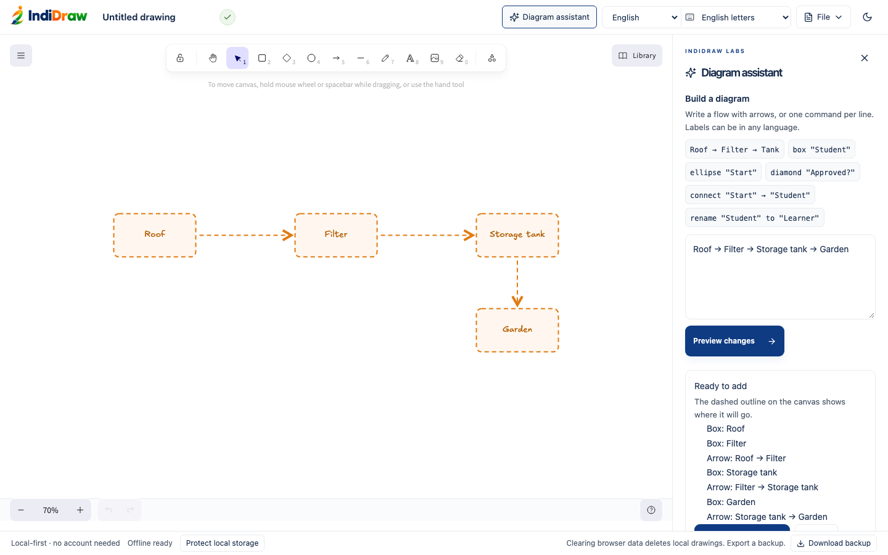

# IndiDraw continuous voice canvas

Status: the offline command engine and Diagram assistant ship in 0.2.0. Live speech, AI interpretation and cloud voice hosting are **not implemented** yet; this document records the design and the plan for them.

<p align="center"></p>

## What can be tested now

Open a drawing, choose **Diagram assistant**, then choose an example, click a command chip or type a command. **Preview changes** checks the entire instruction and draws a dashed outline on the canvas without changing the drawing. **Apply to canvas** commits it as one undoable native Excalidraw update, and the panel's **Undo** button removes exactly what was added (as long as the canvas hasn't changed since). This explicit offline grammar is a test interface for the command engine, not a natural-language AI model.

```text
Roof → Filter → Storage tank → Garden
```

Or, one command per line:

```text
ellipse "Start"
box "Review"
diamond "Approved?"
connect "Start" → "Review"
connect "Review" → "Approved?"
```

Follow up with `rename "Review" to "Check"`. Hindi labels work too: `वर्षा → छत → फ़िल्टर → पानी की टंकी`. Labels are literal text, not translation or transliteration. Existing Hindi phonetic typing on the canvas is unchanged.

Connect and rename address assistant-created shapes by their current bound label, including after native export/import or local reopening. Manual label edits are read from the canvas on the next preview. Hand-drawn elements are preserved and considered during placement. Native arrows have bindings on both ends so they follow ordinary canvas edits.

Shape labels use the hand-drawn Excalifont, or the matching Noto font for labels written in an Indian script. The panel and its error messages are translated into all seven interface languages. Command keywords (`box`, `connect`, `rename … to …`) stay in English; flows written with arrows work with labels in any script.

Known limits: commands use the grammar shown above; no pronouns, arbitrary prose, deletion, grouping or moving commands yet. Labels are limited to 120 UTF-16 code units and batches to 60 operations. Framed, rotated and locked assistant shapes cannot be edited by the adapter. A rename that enlarges a connected shape is rejected with instructions to resize it first. Placement is a conservative grid, not ELK layout. Small-screen panels overlay the canvas and can be closed.

## Design decisions

- Retain React/TypeScript/Vite and Excalidraw 0.18.1. Preserve existing local persistence, fonts, translations, import/export and undo.
- Build an original IndiDraw command protocol and adapter. No source has been copied from the ACADEE repository, and no new third-party dependency is added for this phase.
- Providers emit data, never executable JavaScript. Runtime validation allowlists supported operations and strips other fields.
- Use native element IDs and bound labels as the current source of truth. Assistant ownership and recent batch receipts live in versioned `customData`, which survives native scene saving. Image exports remain normal images.
- Apply atomically. A rejected operation leaves the original scene untouched. Keep deleted elements for native history; never overwrite the scene with only assistant output.
- Bind a preview to the complete scene's ID/version/nonce/deletion signature. Any intervening edit invalidates the preview; the user must regenerate it.
- Keep the most recent 256 batch receipts per touched element to suppress replayed deliveries. After that window a conflicting create fails by ID. The future server needs a separate acknowledged sequence log; these local receipts are not an exactly-once network protocol.
- Do not attach a microphone, simulate listening or silently incur AI costs before a real service is configured.

## Target architecture for the next stages

1. Browser audio over LiveKit WebRTC to a separately hosted Node.js/TypeScript voice process. Cloudflare continues to serve the static website and authenticated API gateway. Do not attempt to run an ordinary long-running Node agent inside a static deployment.
2. Streaming speech adapter: benchmark OpenAI live transcription and Deepgram multilingual streaming on the same English/Hindi/Hinglish recordings. Select using measured recognition errors, delay and cost. Pin the chosen SDK/model versions after the comparison. Provider language support does not prove code-switching quality.
3. Clause scheduler consuming interim and final transcript events. Process meaningful clauses during uninterrupted speech, independent of end-of-turn detection. Bound speculative requests, coalesce incoming text and cancel superseded work.
4. Interpreter producing the versioned operation protocol, extended with session ID, transcript segment/revision, base scene revision, monotonic sequence and acknowledgement ID. Resolve referents from compact graph context. Reject stale responses when the user edits the target or corrects the transcript.
5. Separate provisional preview layer from committed native canvas elements. Confirm stable operations automatically under the chosen interaction policy; the manual preview/apply buttons in this first phase are not the final continuous-voice interaction.
6. Fast local placement for immediate appearance; ELK.js in a Web Worker for constrained arrangements. Preserve user-moved nodes. Reconcile a changed region instead of laying out the whole drawing on each delta.
7. Authenticated voice sessions, short-lived connection tokens, server-only provider secrets, per-user minute/token/concurrency caps, cancellation, usage accounting and spend limits. No raw audio retention by default.
8. Persistent ordered session events and reconnect acknowledgements. Add cloud drawing sync only as a separate feature; the existing IndexedDB save path remains available.

No model is declared the fastest or best without measurements. A useful initial goal is a visible committed update within 1–2 seconds of a sufficiently clear clause, measured at p50 and p95 on representative devices and networks. This is a target, not an achieved result.

## Acceptance tests for live voice

Use two-minute continuous explanations with Indian accents, native Hindi, Hinglish, background noise, pauses, corrections and repeated labels. Record speech-to-preview delay, speech-to-commit delay, incorrect/missing operations, accidental duplicate nodes, layout movement, undo accuracy and cost per completed diagram. Test Safari and Chromium microphone permission, loss of network, resumed sessions and stop/cancel behavior. Never gate all drawing on silence.

Example: “Create Student, connect it to Teacher, actually call that School, put a second box called Parent below Student, connect Parent to School.” A correction must update the intended existing shape without rebuilding unrelated work.

## Verification for the implemented foundation

- `pnpm typecheck`
- `pnpm lint`
- `pnpm test`
- `pnpm build`
- `pnpm exec playwright test tests/e2e/assistant.spec.ts --project=chromium --project=webkit`
- Existing Hindi browser suite to verify canvas integration remains intact.

Manual checks: preview leaves the canvas unchanged; discard applies nothing; apply adds editable shapes; Undo removes the entire instruction and Redo restores it; rename keeps IDs stable; missing targets leave all work unchanged; save/reopen and native/PNG/SVG export retain labels; disconnect the network and run another explicit command.

Results on 25 October 2026: typecheck, lint, 56 unit tests and production build passed. The complete Chromium/WebKit browser suite passed 52 tests with production security headers. After final layout and keyboard-focus refinements, all 8 focused assistant browser tests passed, including scoped WCAG AA checks in light/dark themes. Screenshots were inspected visually. These results cover the local foundation, not live speech performance. The full-suite run emitted one upstream WebKit language-module warning during offline testing, while its language preservation and offline assertions passed.

## Source files

- `src/editor/assistant/commands.ts`: allowlisted protocol, runtime validation, explicit offline planner.
- `src/editor/assistant/scene.ts`: native canvas adapter, identities, bindings, placement and replay receipts.
- `src/editor/assistant/DiagramAssistant.tsx`: panel, dry-run preview, atomic apply and undo.
- `src/editor/assistant/AssistantGhost.tsx`: dashed on-canvas preview of a pending batch.
- `src/editor/labelFont.ts`: script-aware fonts for generated labels.
- `src/editor/Editor.tsx`: panel toggle and workspace integration.
- `src/styles.css`: responsive panel and controls using existing theme tokens.
- `tests/assistant.test.ts`: protocol and planner tests.
- `tests/e2e/assistant.spec.ts`: browser coverage.
- `docs/VOICE-CANVAS.md`: this implementation record and next-stage architecture.

## References checked

- [Excalidraw imperative API and undo capture](https://docs.excalidraw.com/docs/@excalidraw/excalidraw/api/props/excalidraw-api)
- [Excalidraw skeleton conversion](https://docs.excalidraw.com/docs/@excalidraw/excalidraw/api/excalidraw-element-skeleton)
- [LiveKit Agents JS](https://github.com/livekit/agents-js)
- [LiveKit session management](https://docs.livekit.io/agents/logic/sessions/)
- [OpenAI streaming transcription](https://developers.openai.com/api/docs/guides/realtime-transcription)
- [Deepgram model/language support](https://developers.deepgram.com/docs/models-languages-overview/)
- [ELK.js](https://github.com/kieler/elkjs)
